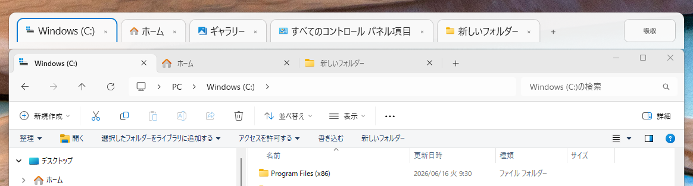

# KjTabBar

[Japanese README](./README_jp.md)

KjTabBar is a resident desktop application that integrates Windows Explorer (`explorer.exe`) with a custom tab bar so you can use it like a tabbed file manager.
Instead of hooking into or modifying Explorer itself, it places an independent tool window tightly above Explorer, providing stable behavior and high compatibility.



## Features

- **Tabbed window integration**
  - Multiple Explorer windows are managed across the system and consolidated into a single tab bar window.
- **Drag and drop support**
  - Reorder tabs with left-button drag
  - The dragged tab keeps an orange outline, including outside the bar; a blue bar marks the insertion position. Tab dragging uses an arrow cursor.
  - Drag a tab out of the tab bar and drop it outside the Explorer window to move that tab into a new window and close the source tab
  - Move or copy files and folders onto tabs by dropping items from outside
  - Drag an independent Explorer window onto the dedicated merge zone at the right edge of the tab bar to absorb it as a new tab
  - When absorbed by dragging, Control Panel items such as Power Options are added as separate tabs even when an equivalent tab already exists
  - Show a context menu on right-drag drop such as "Copy here", "Move here", and "Create symbolic link here"
  - Symbolic links are first created with the current user privileges. If privileges are insufficient, a dedicated helper retries only the failed links as administrator after Windows UAC approval. Canceling UAC stops that retry.
- **Seamless tracking and UI integration**
  - Tracks Explorer position, size, and DPI scale changes in real time
  - Automatically follows the Windows dark/light mode setting
- **Stable resident behavior**
  - Stays in the system tray and manages resources appropriately in the background
  - Because the application is highly independent from Explorer itself, it is designed to be less affected by Windows updates and similar changes

## Requirements

- OS: Windows 10 / Windows 11
- Runtime: .NET Framework 4.8.1

## Tab selection for desktop launches

Only when a folder, special item, or shortcut to one is opened from the desktop, select an existing tab for the same location in the destination tab bar and bring its window to the foreground; add a new tab if no match exists. This applies to ordinary folders and all special folders, including Control Panel and its sub-items, This PC, Network, and Recycle Bin.

- If multiple tabs match, prefer the active matching tab; otherwise select the leftmost match. Keep existing duplicate tabs.
- Match special folders by identifier or normalized path, not display name. Distinguish Control Panel itself from each of its sub-items.
- If you switch to another app while an asynchronous absorption or host restoration is pending, completion does not bring Explorer to the foreground.
- Duplicate Tab, adding tabs by dragging, absorbing windows by dragging, and the + button still create new tabs even for matching locations. Dragging from the desktop is also excluded from reuse.
- Do not apply reuse to launches from other sources or internal window creation during tab operations.

This behavior is implemented in the source. Launch-origin detection, display, and window switching still require validation through actual desktop interactions.

## Usage

1. Launch the application (`KjTabBar.exe`). It will stay resident in the system tray.
2. Open Windows Explorer. A tab bar will automatically appear at the top of the window.
3. Opening a folder, special item, or shortcut to one from the desktop selects an existing tab for the same location. If no tab matches, a new tab is added.
4. **Tab operations**
   - `Reopen Closed Tab` restores the last closed tab to its position when it was closed and selects it. Tabs closed together are restored in their original order. If the saved position is beyond the current tabs, the tab is restored at the end.
   - Use the `+` button on the right to open a folder-picker dialog and add a new tab.
   - Each tab shows a per-path icon, including shell-specific icons for special folders and Control Panel sub-items.
   - Right-click a tab to access actions such as `Duplicate Tab`, `Open in New Window`, `Copy Path`, and `Close Tab`.
   - Selecting another tab during an availability check cancels the previous wait and prioritizes the latest selection. Stale results never select or close a tab.
   - To avoid accidental dragging when selecting a tab, dragging starts only after the pointer leaves the tab you pressed and moves beyond the system drag threshold. Moving within that tab does not start a drag.
   - Drag a tab with the left mouse button to reorder it. The source tab has an orange outline; release at the blue insertion bar. Outside the tab bar, the orange outline remains on the source tab and the cursor stays an arrow.
   - Drag a tab outside the tab bar and drop it outside Explorer to reopen that tab as a separate window and close the original tab.
   - To merge an independent Explorer window, drag it onto the dedicated `Merge` zone at the far right of the tab bar and release it there.
   - Left-click blank tab bar space or the Merge zone to bring Explorer forward. Hold the left button and drag to move the entire Explorer window; release the button to stop.
   - A partially covered destination accepts absorption when the drop point remains exposed.
5. **Settings**
   - Right-click the background area of the tab bar and choose `Settings...` to change options such as the tab font size. The ×, +, and Merge labels also follow this font size.
6. To exit, right-click the task tray icon and choose `Exit`.

## Installation and Uninstallation

- During installation, the setup custom action registers the application for startup (`HKCU\Software\Microsoft\Windows\CurrentVersion\Run`).
- During uninstallation, the dedicated uninstaller cleans up only the matching auto-start registry entry. The settings file (`settings.xml`) and DPAPI-protected tab state (`tabs.snapshot.txt`, with `tabs.txt` and `tabs.active.txt` compatibility copies) are kept under `%APPDATA%\KjTabBar` as user data.

## License

This project is distributed under the **MIT License**.
For details, see the [LICENSE](LICENSE) file.

## Download

Latest version:

https://github.com/keasj/KjTabBar/releases/latest

## Export and import tab lists (v1.4.6.0)

Right-click a tab or the tab bar background and choose Export Tab List or Import Tab List.
The `.txt` file uses UTF-8 (export: no BOM, CRLF; import: optional BOM, CRLF or LF).

```text
active=1
C:\Users
D:\Documents
shell:RecycleBinFolder
```

`active` is zero-based: this example selects the second tab. Import replaces the current window's list,
preserving order, duplicates, Unicode, UNC paths and Shell paths without checking folder existence or access.
Navigation to the selected tab is attempted; unavailable entries remain in the list.
Up to 255 tabs are imported. Larger lists show a warning and replace the current list with the first 255 entries. If the selected index is outside that range, the first tab is selected.
Invalid files (including empty lists, blank entries and out-of-range indices) leave the current tabs unchanged.
File read/write errors are displayed. The menu is disabled while a tab operation is in progress.
